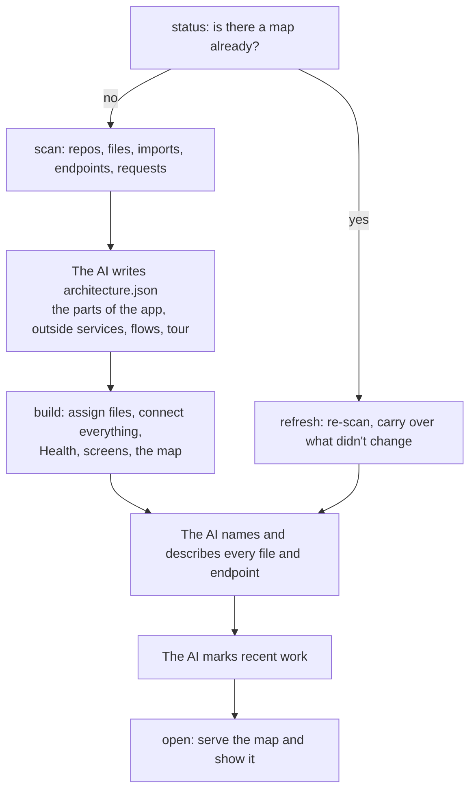

# How it works

Floorplan splits the work between scripts and the AI you run it in, Claude Code or Codex. The scripts do everything mechanical: finding files, parsing code, matching requests to endpoints, laying out the map. They're plain Node.js with no dependencies, and they cost no tokens. The AI does what only a reader of the code can: deciding what the parts of your app *are*, and explaining them plainly.

## 1. Scan

`scan.mjs` finds every git repository under the folder you point it at (one repo, a monorepo, or several repos side by side), skipping duplicate worktrees. It lists files with git, so your `.gitignore` is respected, then extracts from each file:

- **imports**, resolved to real files: TypeScript path aliases, Python packages, Go modules, Rust crates, JVM packages, Swift modules;
- **exported definitions** and their doc comments;
- **endpoints** the server defines;
- **web requests** the code makes;
- content **fingerprints**, so later updates can tell what changed.

Supported languages: TypeScript and JavaScript (including Vue, Svelte and Astro files), Python, Swift, Go, Rust, Java, Kotlin, Scala and Groovy, with lighter support for others.

### Swift

Swift files in one module never import each other, so imports alone would leave an app's files unconnected. Floorplan works in three steps:

1. **Modules.** Each target becomes a module, read from `Package.swift` (targets, their folders and dependencies, products, remote packages), XcodeGen's `project.yml` (each target's `sources` and dependencies) or, when neither exists, the Xcode project (target names and their folders). Every Swift file belongs to the module whose folder holds it most specifically, and the scan summary lists the modules, which make good parts for the map.
2. **Links by name.** Each file's top-level types, functions and constants (and public nested types) go into an index. A file links to another when it uses a name the other declares, outside comments and strings (multi-line `"""` and raw `#"…"#` strings included), in its own module or a module it imports. A name used by more than 40% of the Swift files (when there are at least 10) links nothing, so one everywhere-type doesn't drown the map; the summary says which names were left out.
3. **Outside parts.** `import CloudKit` becomes iCloud, HealthKit Apple Health, EventKit Calendar & Reminders, and so on; plain platform frameworks (Foundation, SwiftUI, UIKit) are left out. Remote packages are outside libraries.

A file's description starts from its header comment (Xcode's "Created by" template is skipped) or the `///` or `/** */` doc comment on its first type.

## 2. Connecting requests to endpoints

The most useful lines on the map connect a screen's web requests to the server code that answers them, often across repos. Floorplan:

- **Finds endpoints** in Express, Koa, Hono, Next.js (route files and API routes), Firebase Cloud Functions, Flask, FastAPI, Django, Go (net/http, Gin, Echo, chi, Fiber), Actix, Axum, Spring, Vapor and Hummingbird.
- **Reads hand-written routers**: a Cloudflare Worker or other `fetch` handler comparing `url.pathname` (`path === "/x" && method === "POST"`, `path.startsWith("/signin")`, `switch (pathname)`), a Swift server switching on method and path (`case ("POST", "/mcp")`, `p.hasPrefix(…)`, `switch path`), and Python's http.server (`self.path == "/x"` inside `do_GET`). A "known paths" check above the router adds nothing of its own.
- **Lists MCP tools as endpoints.** An MCP server's tools are what AI agents can do with the app, so each is an endpoint `TOOL /mcp/<name>` with its description: from the TypeScript SDK (`server.tool`, `registerTool`), Python's `@mcp.tool`, a tools array whose entries are made by one helper with a snake_case name first (`t("get_context", …)`), or a JSON tool list the server imports. Tools are never matched to web requests; they're reached through the server's `/mcp` address.
- **Resolves prefixes**: Flask blueprints registered with a `url_prefix`, and Express routers mounted with `app.use('/api/users', usersRouter)`, including routers mounted inside other routers and mounts with middleware in front.
- **Finds requests** made with `fetch`, axios, ky, `requests` and similar, including:
  - addresses built in a variable first: `const url = …; api.get(url)`;
  - template strings with nested parts;
  - small helpers in the same file that add a prefix, like `call('/definitions')`;
  - Swift's `URL(string: "https://…")`, with `\(…)` interpolations read like template parts.
- **Firebase Cloud Functions** are called by name rather than by address. A callable function (`onCall`) shows up as `CALL /approveItem` under the name your functions entry file exports it as, and the website's `httpsCallable(functions, 'approveItem')` calls reach it, including through a helper of your own that wraps `httpsCallable`. An `onRequest` function is an ordinary endpoint at `/<name>`, and an Express app passed to it keeps its own routes under that name. Scheduled and other background functions (Firestore, Storage, Pub/Sub) are listed for the AI to place on the map.
- **Matches** the two. When a request only spells out part of the address, because the base URL lives in settings, Floorplan learns each client's base path and prefers matches that fit it.

It's pattern matching, not a compiler, so it catches most connections but not all. If an important link is missing, ask for it to be added to the floorplan, and it will record it as an explicit connection.

## 3. The AI describes the system

Claude or Codex reads the scan summary, READMEs, setup files and entry points, then writes `architecture.json`:

- the main parts of your app, each with a plain summary;
- the outside services it really talks to (databases, payment providers, email);
- connections the scan can't see, like queues, scheduled jobs and webhooks;
- a few guided flows and a "Start here" tour.

The build then assigns every file to the deepest part whose patterns match, and reports anything left over.

Next, `describe.mjs` writes a worksheet for each part. A worksheet is a digest of every file and endpoint: what it defines, its doc comments, what it uses and what uses it. The AI fills in a name and description for each. On large projects, Claude Code splits the worksheets across parallel helpers.

By default everything is written for the app's owner, not an engineer: what each thing does for the business, in everyday words. Ask for a developer-facing map and it switches to technical style.

## 4. Build

`build.mjs` validates everything the AI wrote and reports problems by name ("did you mean …"). It then:

- connects the parts, using imports, matched requests and the AI's explicit connections;
- runs the **Health** check;
- detects **screens**: Next.js, React Router, Vue, SvelteKit, Remix, Nuxt, Astro, Expo, Angular, TanStack;
- writes `graph.json` and the self-contained `index.html`, noting whether Claude Code or Codex made it, so the map's Ask bar and fix prompts name the right one.

The map lays itself out in your browser with [ELK](https://eclipse.dev/elk/), so the build itself is fast.

## 5. Recent work

After every make or update, the AI records what was just worked on in `recent-work.json`. `recent.mjs` lists the facts: what changed since the last map, uncommitted changes, and recent commits, each matched to its card. The AI adds the *why*: what you asked for, and how each change serves it. The previous highlights are replaced every time.

## 6. Showing it

`open.mjs` starts the map's small local server in the background and opens your browser. If the server is already running for this map, it's reused, and any open tab reloads itself in place instead of a new one opening.

## Updates

`refresh.mjs` re-scans and compares against the last build, using each file's fingerprint:

- **exact content**, which spots edits, renames and moves;
- **signature**: its exports, endpoints and doc comments. Edits inside function bodies don't count.

It then:
- carries descriptions over to moved and renamed files and endpoints;
- drops entries for deleted files;
- flags entries whose signature changed, for review.

Then it rebuilds. The AI only has to describe what's new or flagged, and check the structure if the change was large. That's why updates are quick.

## Asking questions

The map's server answers each question with the AI on your computer, in your project:

- **Claude Code:** it runs `claude -p` with read-only tools only: reading and searching files, and `floorplan/query.mjs`, which looks things up in the map.
- **Codex:** it runs `codex exec` in Codex's read-only sandbox, with the same lookups. These runs aren't saved to your Codex history, so a follow-up brings the last few questions and answers along.

It uses whichever made the map, and the other one if that isn't installed. Either way it answers with text plus the cards to show, so answers can cite real code.

In the Claude app, the map asks Claude through the app instead, with the same lookups but no access to your source.

The same lookups help ordinary Claude Code sessions. The short section Floorplan adds to `CLAUDE.local.md` tells them to check the map (`query.mjs find`, `show`, `path`, `overview`) before searching the code from scratch.
